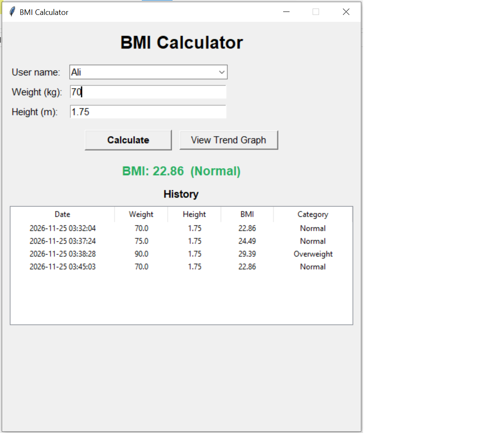
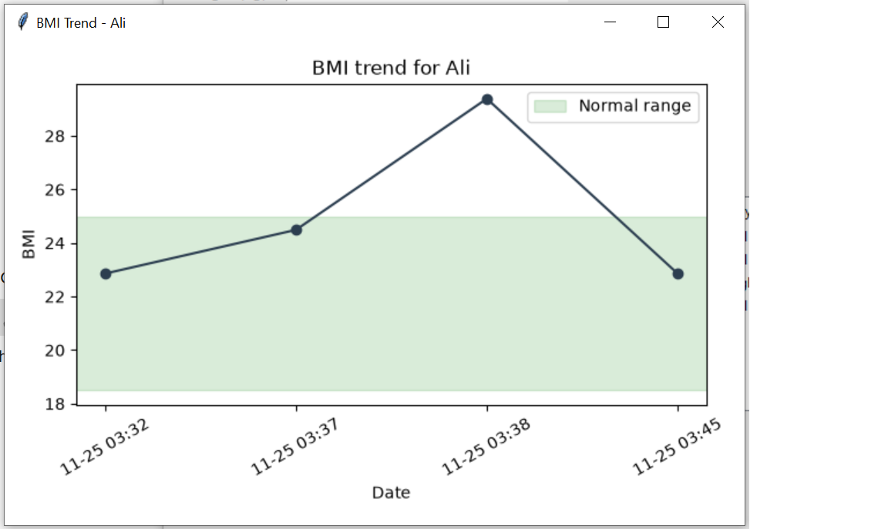

# BMI Calculator (Advanced Tier)

**Oasis Infobyte Internship - Python Programming Track**

**Task 2: BMI Calculator**

**Intern:** Merajuddin Suhil Sarwar

## Description

A desktop BMI (Body Mass Index) calculator built with Python and tkinter. It supports multiple users, saves every calculation in a local SQLite database, and shows a BMI trend graph over time.

## Features

- GUI window built with tkinter
- Input fields with labels for user name, weight (kg) and height (m)
- "Calculate" button
- Colour-coded result:
  - Blue = Underweight (< 18.5)
  - Green = Normal (18.5 - 24.9)
  - Orange = Overweight (25 - 29.9)
  - Red = Obese (>= 30)
- Input validation: rejects empty names, non-numeric values and negative or unrealistic values
- Multi-user support: records are saved per named user
- Historical records stored in an SQLite database
- Trend graph: line chart of a user's BMI over time (matplotlib)
- Error handling for database read/write failures

## BMI Formula

BMI = weight (kg) / height (m)^2

## Technologies Used

- Python 3.13
- tkinter
- sqlite3
- matplotlib

## How to Run

1. Open the project folder:

   ```
   cd Python-Task2-BMICalculator
   ```

2. Create and activate a virtual environment:

   ```
   py -3.13 -m venv venv
   venv\Scripts\activate
   ```

3. Install the dependencies:

   ```
   pip install -r requirements.txt
   ```

4. Run the app:

   ```
   python bmi_calculator.py
   ```

## How to Use

1. Type a user name, weight in kg and height in metres (for example 70 and 1.75).
2. Click **Calculate** to see the BMI and category.
3. Select a user name from the list to view that user's history.
4. Click **View Trend Graph** (needs at least 2 records) to see the BMI trend.

## Screenshots




## Data Storage

All records are saved locally in `bmi_data.db` (SQLite). This file stays on your computer and is not uploaded to GitHub.