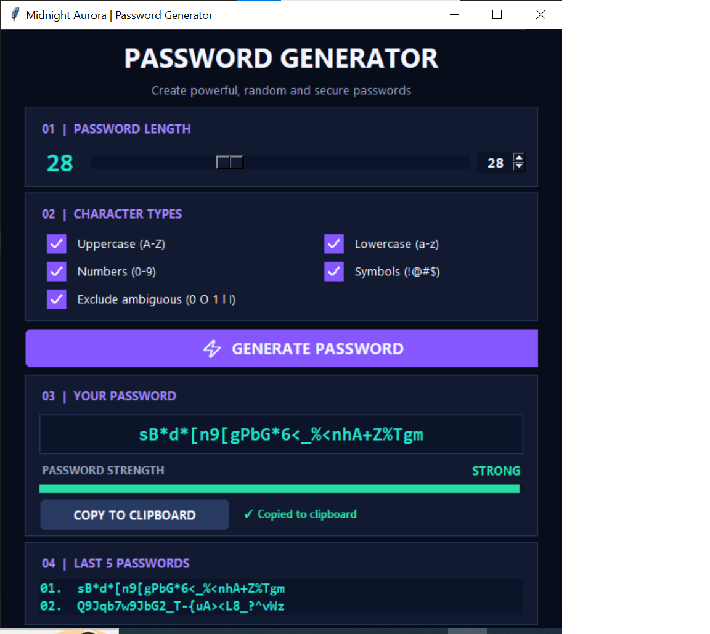

# Random Password Generator (Advanced Tier)

**Oasis Infobyte Internship - Python Programming Track**

**Task 3: Random Password Generator**

**Intern:** Merajuddin Suhil Sarwar

## Description

A desktop password generator built with Python and tkinter. It creates strong random passwords using the cryptographically secure `secrets` module, shows a strength indicator, and copies the password to the clipboard automatically.

## Features

- GUI window built with tkinter (modern dark theme)
- Custom round slider and spinbox for password length (minimum 8)
- Character type checkboxes: uppercase, lowercase, numbers, symbols (at least 2 required)
- Uses the `secrets` module (not `random`) for secure generation
- Guarantees at least one character from each selected type
- Strength indicator: Weak / Medium / Strong with a colour bar
- "Copy to Clipboard" button using `pyperclip`; password is also copied automatically on generation
- Option to exclude ambiguous characters (0, O, 1, l, I)
- History of the last 5 passwords (session only, never saved to a file for security)
- Input validation with clear messages

## Technologies Used

- Python 3.13
- tkinter
- secrets
- pyperclip

## How to Run

1. Open the project folder:

   ```
   cd Python-Task3-PasswordGenerator
   ```

2. Create and activate a virtual environment:

   ```
   py -3.13 -m venv venv
   venv\Scripts\activate
   ```

3. Install the dependencies:

   ```
   pip install -r requirements.txt
   ```

4. Run the app:

   ```
   python password_generator.py
   ```

## How to Use

1. Choose the length with the slider or the number box.
2. Select at least two character types.
3. Click **Generate Password**.
4. The password is copied automatically. Use **Copy to Clipboard** to copy it again.

## Security Notes

- Passwords are generated with `secrets`, which is designed for security-sensitive use.
- Generated passwords are kept in memory only during the session and are never written to disk.

## Screenshots

